# AI4SOAR hands-on challenges

Four live demonstrations of what AI4SOAR does, from a hand-built SOAR workflow to a
response playbook written by an LLM for an alert no template covers. The presenter runs
them on the Montimage server; participants follow on screen and can repeat everything on
their own machine with [INSTALL.md](../INSTALL.md).

| # | Challenge | What it shows |
|---|---|---|
| 1 | Build a SOAR workflow in Shuffle | the CACAO playbook *Check Attacker IP Reputation and Block if Malicious* as a Shuffle workflow: an app (VirusTotal), a decision with two branches, a notification, an action on a machine |
| 2 | Path A: known technique | an alert that already carries its MITRE ATT&CK technique gets its tested playbook instantly (no AI), dry-run on SOARCA and run for real in Shuffle |
| 3 | Path B: the LLM names the technique | an alert without any technique tag: Claude attributes it, the matching templates are filled with the alert's values and run |
| 4 | Path D: the LLM writes the playbook (+ verification) | an alert no template covers: Claude writes a CACAO 2.0 playbook, AI4SOAR verifies it (schema, structure, commands, LLM review), the analyst can edit it, then it runs |

Path C (similarity to past incidents) needs historical data and is not demonstrated.

---

## The demo setup

| Component | Where | Role |
|---|---|---|
| AI4SOAR | https://ai4soar.montimage.eu | alerts, orchestration (paths A/B/D), playbook library, verification, tickets |
| Shuffle | https://shuffle.montimage.eu | open-source SOAR: runs the playbooks for real |
| SOARCA 1.1.0 | next to AI4SOAR | TNO's open-source CACAO orchestrator: dry runs |
| **web-01** (demo victim) | Docker container, `172.17.0.1:2224` | an empty Debian server the playbooks act on: users alice, bob, dev, a suspicious `/tmp/payload.sh`, a crypto-miner and its crontab, a hidden setuid file… Every change stays inside the container |
| fw-sandbox | Docker container, `172.17.0.1:2223` | the "firewall host" of the reputation playbook in Shuffle's library |
| LLMs | Anthropic/OpenAI API/Ollama | Path B attribution, Path D generation, LLM review |

All checks green on the **Integration Status** page before starting:

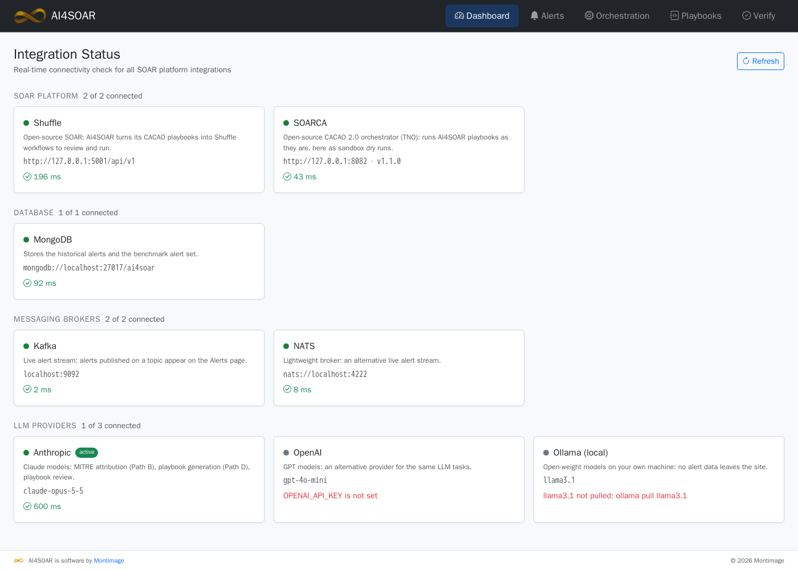

**Before the demo, and after re-running an alert that removed what it acts on**, reset web-01 if needed to its starting state (5 s, touches nothing else):

```bash
docker compose -f docker-compose.lab.yml --env-file .env up -d --force-recreate   # from the ai4soar folder
```

The **Alerts** page lists the demo alerts first (all about web-01), then the 37-alert
MMT / Suricata / Snort benchmark:

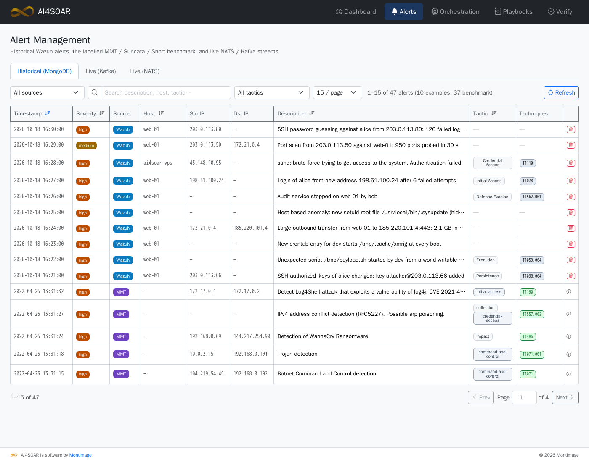

---

## Challenge 1: build a SOAR workflow in Shuffle

**Goal.** Understand what a SOAR playbook is by building one: *when an alert names an
attacking IP, look it up on VirusTotal; if security vendors flag it, notify the SOC and
block it on the firewall, with no human step.* It uses the four building blocks of every
workflow: an integration (the VirusTotal v3 app), a decision with two branches, a
notification and an action on a machine. In AI4SOAR this playbook is a CACAO 2.0 template
(`playbooks/t1110_ip_reputation_block.yaml`); the **Sync to Shuffle** button of the
Playbooks page turns it into the Shuffle workflow below, node for node.

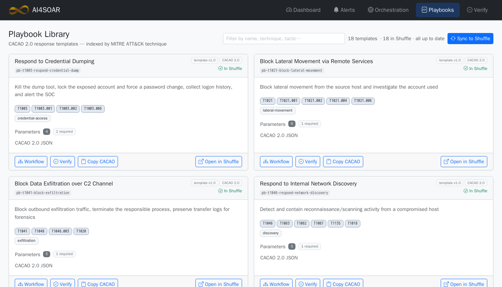

### Steps

1. **Playbooks** page → find *Check Attacker IP Reputation and Block if Malicious* →
   **Workflow** shows the CACAO steps; **Open in Shuffle** opens
   *AI4SOAR library · Check Attacker IP Reputation and Block if Malicious*.
2. In Shuffle, walk through the five nodes (or build them yourself: drag each app onto
   the canvas, pick the action, fill the fields):

   | Node | App · action | Configuration |
   |---|---|---|
   | **Look up src_ip on VirusTotal** (start) | Virustotal_v3 1.1.0 · *Get an IP address report* | `apikey` = your VirusTotal key · `url` = `https://www.virustotal.com` · `ip` = `$exec.src_ip` |
   | **Flagged as malicious?** | Shuffle Tools · *Repeat back to me* | `call` = `Flagged as malicious?: $look_up_src_ip_on_virustotal.body.data.attributes.last_analysis_stats.malicious` |
   | **Notify the SOC** | Shuffle Tools · *Repeat back to me* | `call` = `Malicious IP $exec.src_ip: flagged by $look_up_…malicious VirusTotal vendors; blocking it on the firewall host` |
   | **Not malicious, no action** | Shuffle Tools · *Repeat back to me* | `call` = `$exec.src_ip is not flagged by VirusTotal ($look_up_…malicious vendors): no action taken` |
   | **Block src_ip on the firewall host** | Shuffle Tools · *Run ssh command* | `host` = `172.17.0.1` · `port` = `2223` · `user_name` = `ai4soar` · `password` = (from `.env`) · `command` = `sudo iptables -I INPUT -s $exec.src_ip -j DROP && echo "BLOCKED $exec.src_ip on $(hostname)"` |

3. The branches (arrows) carry the decision. Click an arrow to see its condition:

   | From → to | Condition |
   |---|---|
   | Look up → Flagged as malicious? | none |
   | Flagged as malicious? → Notify the SOC | `$look_up_src_ip_on_virustotal.body.data.attributes.last_analysis_stats.malicious` **larger than** `0` |
   | Flagged as malicious? → Not malicious, no action | the same condition, negated (**NOT**) |
   | Notify the SOC → Block | none |

   Two Shuffle notations to explain: `$exec.src_ip` is the *execution argument* (the
   alert's value, given when the workflow is started); `$look_up_src_ip_on_virustotal…`
   reads a field of the VirusTotal node's JSON answer.
4. Run it twice from Shuffle (**Run** with an execution argument), once with a malicious
   IP, once with a private one: the two branches.

### Output

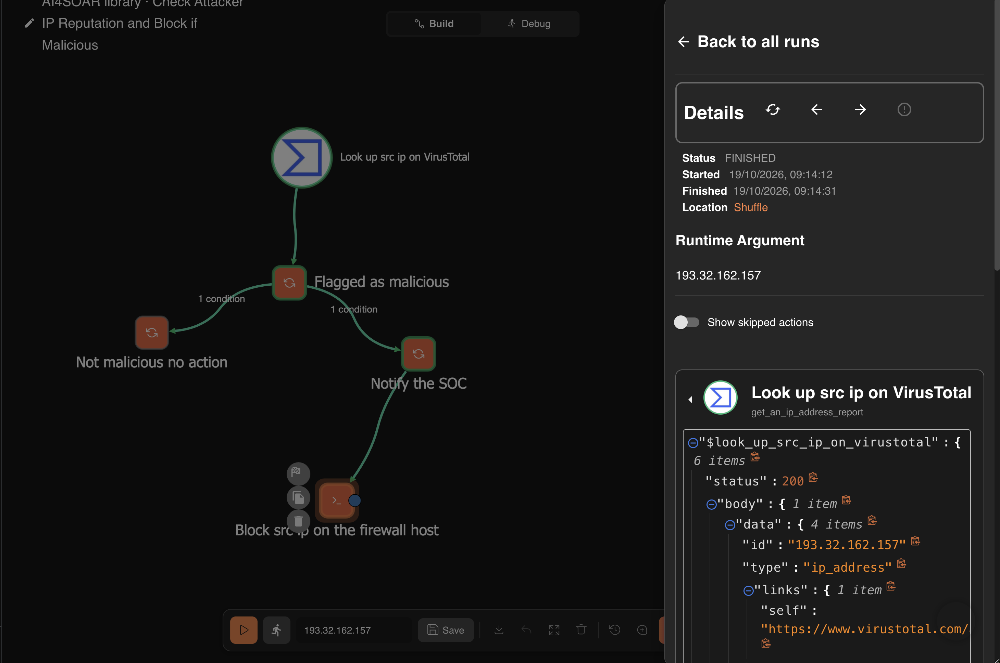

```
== execution argument {"src_ip": "193.32.162.157"} -> FINISHED
  SUCCESS  Look_up_src_ip_on_VirusTotal         HTTP 200, last_analysis_stats = {"malicious": 14, "suspicious": 2, "undetected": 29, "harmless": 47, "timeout": 0}
  SUCCESS  Flagged_as_malicious                 Flagged as malicious?: 14
  SUCCESS  Notify_the_SOC                       Malicious IP 193.32.162.157: flagged by 14 VirusTotal vendors; blocking it on the firewall host
  SKIPPED  Not_malicious_no_action              Minimum of one branch's conditions must be correct to continue. Total: 0 of 1
  SUCCESS  Block_src_ip_on_the_firewall_host    BLOCKED 193.32.162.157 on fw-sandbox

== execution argument {"src_ip": "192.168.0.59"} -> FINISHED
  SUCCESS  Look_up_src_ip_on_VirusTotal         HTTP 200, last_analysis_stats = {"malicious": 0, "suspicious": 0, "undetected": 37, "harmless": 55, "timeout": 0}
  SUCCESS  Flagged_as_malicious                 Flagged as malicious?: 0
  SKIPPED  Notify_the_SOC                       Minimum of one branch's conditions must be correct to continue. Total: 0 of 1
  SUCCESS  Not_malicious_no_action              192.168.0.59 is not flagged by VirusTotal (0 vendors): no action taken
  SKIPPED  Block_src_ip_on_the_firewall_host    Skipped because of previous node (Notify_the_SOC) - 1
```

---

## Challenge 2: Path A, an alert with a known technique

**Goal.** Show the fastest and most trusted path: the alert already carries its MITRE
ATT&CK technique (here Wazuh's `T1110 Brute Force`), so AI4SOAR looks it up in the
playbook library: no AI involved, confidence 100%, the result is auto-executable. The
template from Challenge 1 is the *tested response* for Wazuh's SSH brute-force rules
(`alert_match: rule_ids 5712, 5720, 5763`), so it is recommended alone. The same playbook
is then dry-run on SOARCA and run for real in Shuffle.

### Steps

1. **Alerts** → *sshd: brute force trying to get access to the system. Authentication
   failed.* (host ai4soar-vps, source 45.148.10.95, technique T1110) → it opens on the
   **Orchestration** page.
2. **Run Orchestration**: Path A answers in about half a second.

   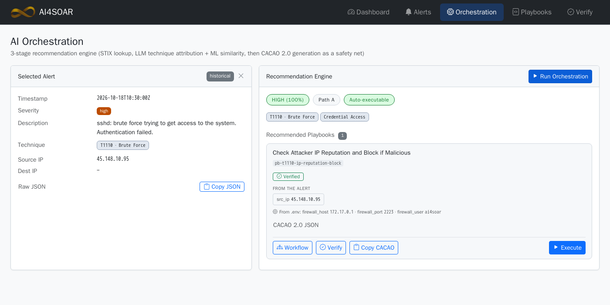

   - **HIGH (100%) · Path A · Auto-executable**, technique `T1110`, tactic Credential Access
   - one recommended playbook, **Verified** (structure, CACAO schema, command safety)
   - *From the alert*: `src_ip 45.148.10.95`; *From .env*: the firewall settings
3. **Execute** → tab **SOARCA (dry run)** → **Dry run on SOARCA**: SOARCA runs the CACAO
   playbook as it is; each step prints what it would do, nothing is changed. The step on
   the branch a dry run does not take is listed as skipped.

   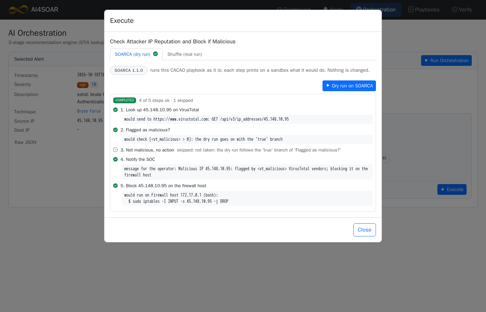

4. Tab **Shuffle (real run)** → **Run now**: the steps appear as they finish…

   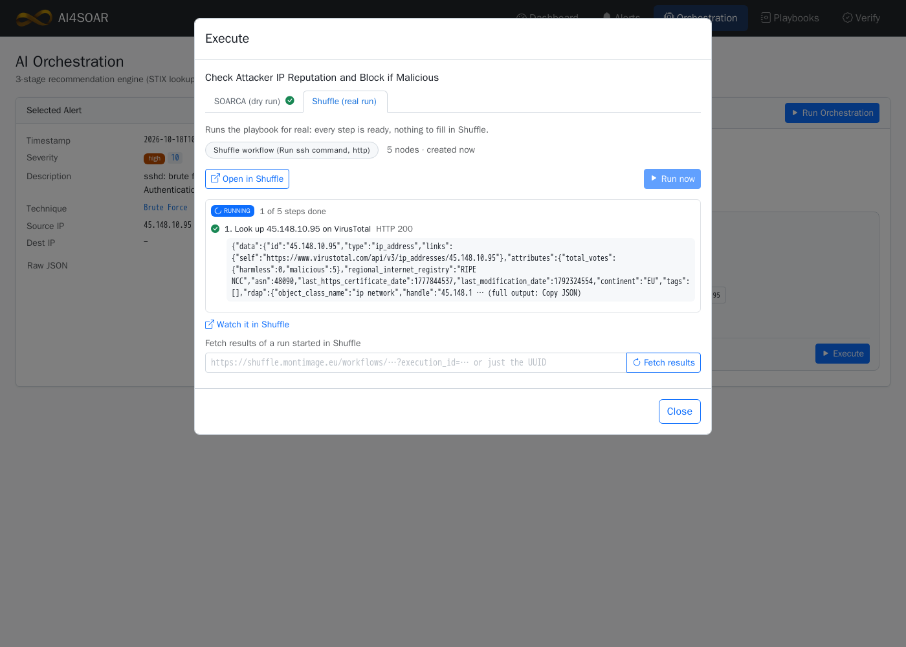

   … and the run completes (**View JSON** / **Copy JSON** show Shuffle's raw execution):

   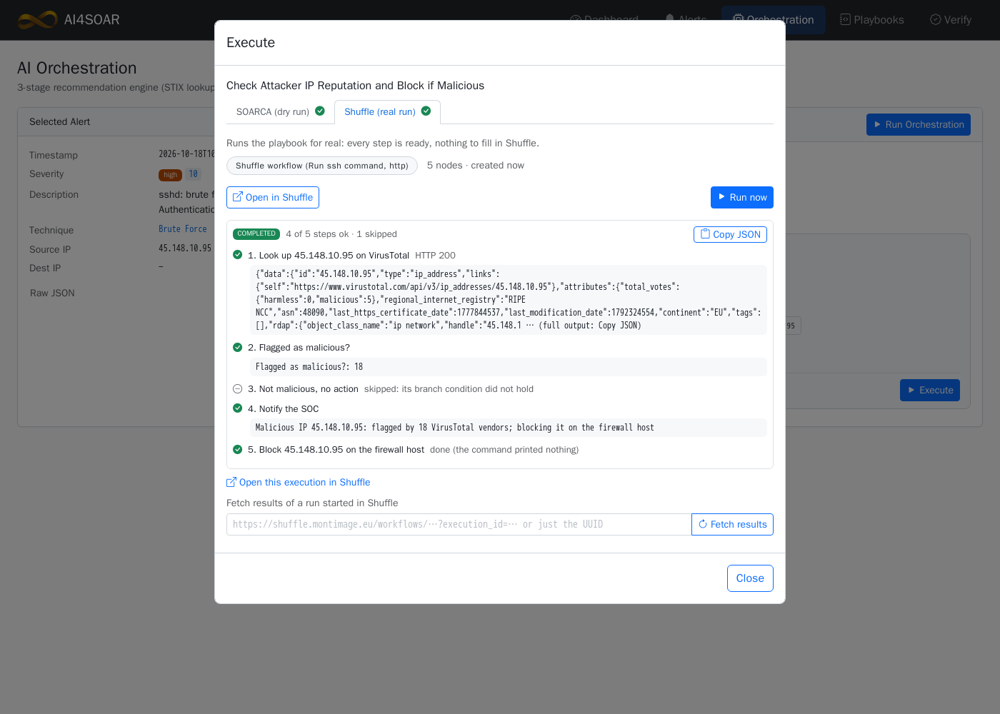

### Output (Shuffle)

```
COMPLETED   4 of 5 steps ok · 1 skipped
✓ 1. Look up 45.148.10.95 on VirusTotal      HTTP 200
✓ 2. Flagged as malicious?                   Flagged as malicious?: 18
⊖ 3. Not malicious, no action                skipped: its branch condition did not hold
✓ 4. Notify the SOC                          Malicious IP 45.148.10.95: flagged by 18 VirusTotal vendors; blocking it on the firewall host
✓ 5. Block 45.148.10.95 on the firewall host BLOCKED 45.148.10.95 on web-01
```

---

## Challenge 3: Path B, the LLM names the technique

**Goal.** Most alerts carry no MITRE technique, only a description and log lines. Path B
asks LLMs to rank the five most likely ATT&CK techniques with a confidence; if it is
confident enough (e.g., ≥ 0.70) and templates exist for them, they are filled with the alert's
values. The analyst approves before execution (**Needs Approval**).

### Steps

1. **Alerts** → *SSH password guessing against alice from 193.32.162.157: 120 failed
   logins in 60 s* (no technique). Its log lines:

   ```
   sshd[2211]: Failed password for alice from 193.32.162.157 port 50112 ssh2
   sshd[2213]: Failed password for alice from 193.32.162.157 port 50114 ssh2
   ... 117 more failed passwords for alice from 193.32.162.157 within 60 s, one every 0.5 s
   ```
2. **Run Orchestration** (a few seconds: one LLM call).
   - **MEDIUM · Path B · Needs Approval**
   - *LLM technique attribution, top 5, most likely first*: `T1110.001 T1110 T1021.004
     T1078 T1133`, confidence 0.90, with the LLM's reasoning
   - recommended: *Block Brute Force Source* and *Check Attacker IP Reputation and Block
     if Malicious*; the values the alert lacks (the affected host) are taken from the demo
     lab and listed in the Execute dialog (hover *Runs on web-01 (demo lab)*)
3. **Execute** *Block Brute Force Source* → **Shuffle (real run)** → **Run now**. Its
   last step creates an incident ticket in AI4SOAR: the ticket pops up at the top right
   of every AI4SOAR page.

   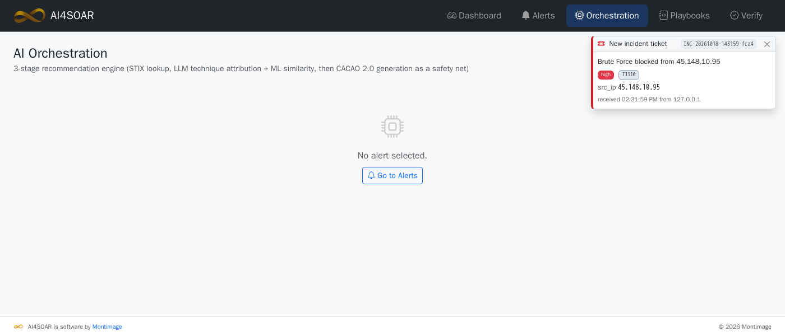

4. Optionally **Execute** the second playbook: 193.32.162.157 is flagged by 14 VirusTotal
   vendors, so it takes the *malicious* branch as in Challenge 1.

### Output (Shuffle)

```
Block Brute Force Source                     COMPLETED   3 of 3 steps ok
✓ 1. Block 193.32.162.157 at firewall for 24h  job 1 at Mon Oct 19 16:40:00 2026
                                               [2026-10-18T16:40:12Z] BLOCKED 193.32.162.157 for 24h (host=web-01)
✓ 2. Lock account alice on web-01              [2026-10-18T16:40:16Z] LOCKED account alice on web-01
✓ 3. Create security incident ticket           HTTP 201 {"id": "INC-20261018-…", "status": "created"}

Check Attacker IP Reputation and Block if Malicious     COMPLETED   4 of 5 steps ok · 1 skipped
✓ Look up 193.32.162.157 on VirusTotal  HTTP 200
✓ Flagged as malicious?                 Flagged as malicious?: 14
✓ Notify the SOC                        Malicious IP 193.32.162.157: flagged by 14 VirusTotal vendors; …
⊖ Not malicious, no action              skipped
✓ Block 193.32.162.157 …                BLOCKED 193.32.162.157 on web-01
```

---

## Challenge 4: Path D, the LLM writes the playbook (with verification)

**Goal.** When no template covers the alert, AI4SOAR does not give up: Path D asks
LLMs for a complete CACAO 2.0 playbook for this alert (investigate, contain, recover,
document), with short commands acting on the affected host. Because it was written by LLMs, it is **verified** before anything runs: the official CACAO 2.0 schema, the workflow
structure, bash syntax, a safety policy (no recursive delete, firewall flush, kill by
pattern…), and an optional LLM review of every command (real? matching its step? harmful
side effects? sensible order?). The security analyst can also edit any step in the Workflow view.

### Steps

1. **Alerts** → *Host-based anomaly: new setuid-root file /usr/local/bin/.sysupdate
   (hidden name, created by user bob)*. On web-01 that file really exists
   (`docker exec demo-victim ls -l /usr/local/bin/.sysupdate` → `-rwsr-xr-x root`).
2. **Run Orchestration** (30–60 s). Path B attributes the alert
   (`T1548.001 Setuid and Setgid`, `T1564.001`, …) but the library has no template for
   these techniques, so Path D generates one: **LOW · Path D · Needs Review**.
   A generated playbook (it differs on every run):

   ```
   Investigate   stat /usr/local/bin/.sysupdate
                 sha256sum /usr/local/bin/.sysupdate
                 pgrep -a -x .sysupdate
   Contain       pkill -9 -x .sysupdate
                 chmod 000 /usr/local/bin/.sysupdate
                 usermod -L bob
   Recover       mkdir -p -m 700 /root/quarantine
                 mv /usr/local/bin/.sysupdate /root/quarantine/sysupdate.quarantined
                 find /usr/local -xdev -type f -perm -4000
   Document      echo '… INCIDENT T1548.001: hidden setuid-root file … Actions: …' | tee -a /var/log/ai4soar_incidents.log
   ```
3. **Verify** (on the card: structural checks run automatically) → **Verify** button →
   the Verify page, tick **LLM review** → **Run Verification**. Each group lists its
   criteria and their status, with the offending line for any issue. For contrast, the
   **CACAO examples** button loads deliberately broken playbooks; one with a typo, a line
   of plain text and an unclosed quote gives:

   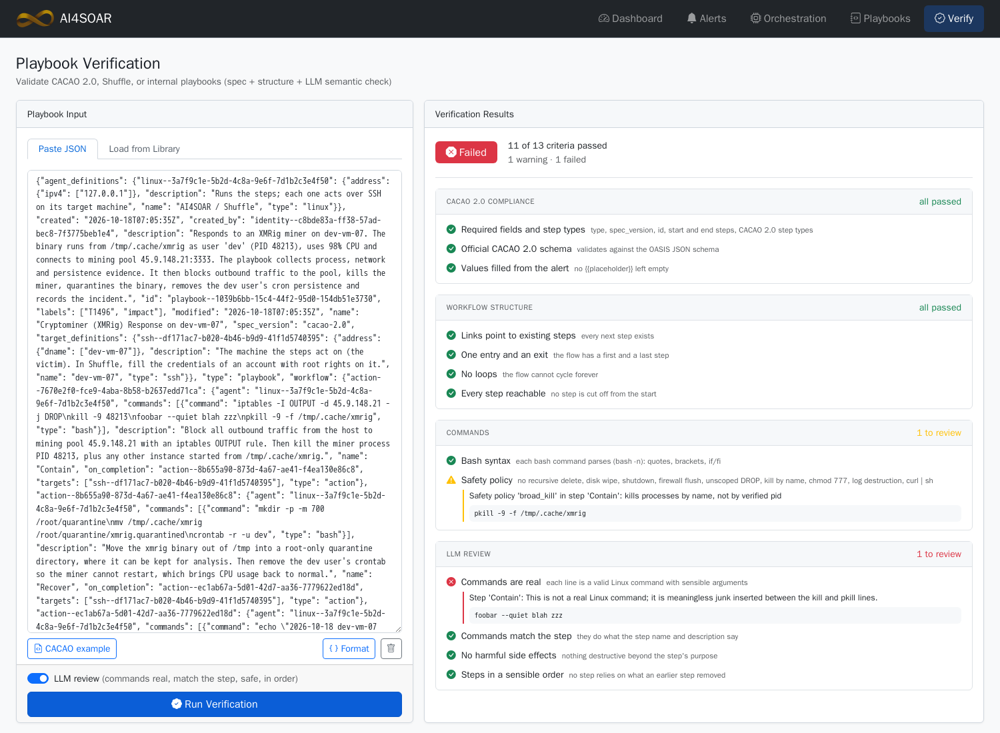

   and a correct one passes all 13 criteria:

   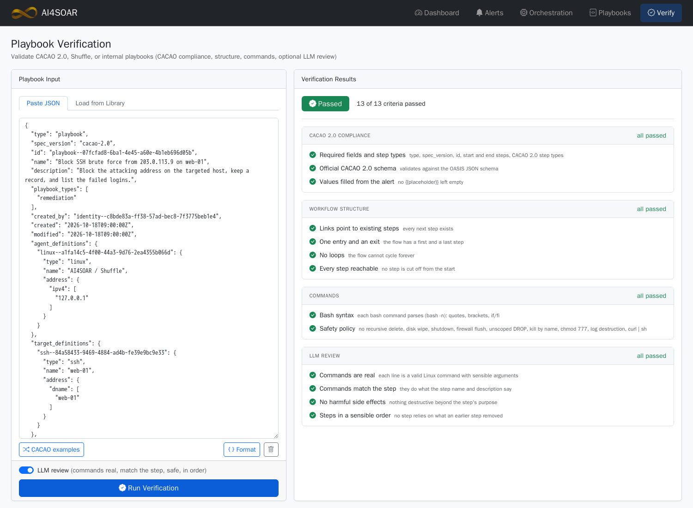

4. **Workflow** → **Edit**: click a node to change its name, description or commands,
   add or delete a command or a step, **Save** (the card is marked *edited*; Verify,
   Copy CACAO and Execute use the edited version).

   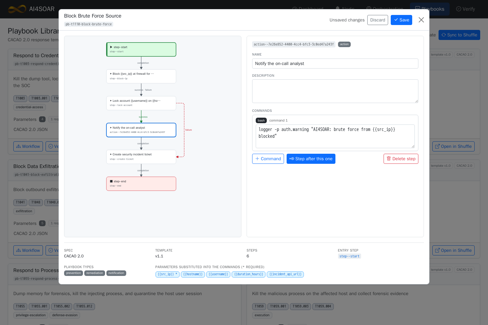

5. **Execute** → **SOARCA (dry run)** then **Shuffle (real run)**.

### Output (Shuffle)

```
COMPLETED   4 of 4 steps ok
✓ Investigate   File: /usr/local/bin/.sysupdate  Size: 48144 … Access: (4755/-rwsr-xr-x)  Uid: (0/root) …
✓ Contain       (no output)
✓ Recover       (no output: no setuid file left under /usr/local)
✓ Document      2026-10-18 web-01 INCIDENT T1548.001/T1564.001: hidden setuid-root file /usr/local/bin/.sysupdate …
```

On web-01 afterwards:

```
$ docker exec demo-victim ls -l /usr/local/bin/.sysupdate
ls: cannot access '/usr/local/bin/.sysupdate': No such file or directory
$ docker exec demo-victim ls -l /root/quarantine
---------- 1 root root 48144 … sysupdate.quarantined
$ docker exec demo-victim passwd -S bob
bob L …
```

---

## Try it yourself

Follow [INSTALL.md](../INSTALL.md): Shuffle, then AI4SOAR, then step 4, the hackathon setup
(SOARCA, the demo lab and the settings of [`.env.hackathon.example`](.env.hackathon.example)). The demo
alerts of these challenges ship with AI4SOAR (`data/example_alerts.json`) and appear on
the Alerts page on first start. You need an Anthropic or OpenAI API key, or local models via Ollama (for paths B and D and LLM review), plus a free VirusTotal API key for the reputation playbook. Everything else runs locally.